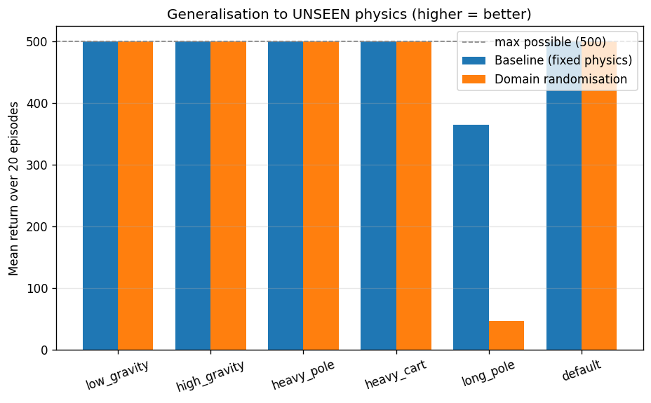

# Domain Randomization for Reinforcement Learning

Train an RL agent on randomized physics, test on unseen conditions. This demonstrates **domain randomization** — a technique to make agents robust by training across a *distribution* of environments instead of one fixed setting.



---

## What is Domain Randomization?

In the real world, conditions are never exactly the same as in simulation. Domain randomization addresses this by **randomizing environment parameters during training** (gravity, mass, friction, etc.), forcing the agent to learn a robust policy that generalizes to unseen conditions.

**Use cases:**
- Sim-to-real transfer in robotics
- Making game AI robust to player behavior
- Training agents that work across hardware variations

---

## The Experiment

We compare **two PPO agents** on CartPole:

| Agent | Training | What it learns |
|-------|----------|----------------|
| **Baseline** | Fixed default physics | Overfits to one specific world |
| **Domain Randomization (DR)** | Physics randomized every episode | Handles variety, generalizes better |

### Randomized Parameters (during training)

| Parameter | Default | Training Range |
|-----------|---------|----------------|
| Gravity | 9.8 | 5.0 – 15.0 |
| Cart mass | 1.0 | 0.5 – 2.0 |
| Pole mass | 0.1 | 0.05 – 0.5 |
| Pole length | 0.5 | 0.3 – 0.7 |

### Test Worlds (unseen during training)

| World | What's different |
|-------|------------------|
| `low_gravity` | Gravity = 4.0 (below training range) |
| `high_gravity` | Gravity = 18.0 (above training range) |
| `heavy_pole` | Pole mass = 0.8 (above training range) |
| `heavy_cart` | Cart mass = 3.0 (above training range) |
| `long_pole` | Pole length = 0.9 (above training range) |
| `default` | Standard CartPole physics |

---

## Problem Formulation

| Element | Description |
|---------|-------------|
| **Environment** | CartPole-v1 (Gymnasium) with physics randomization |
| **State** | 4D continuous: cart position, cart velocity, pole angle, pole angular velocity |
| **Action** | Discrete: 0 = push left, 1 = push right |
| **Reward** | +1 per timestep the pole stays upright (max 500 per episode) |
| **Goal** | Learn one policy that works across a *range* of physics, not just one setting |

---

## Installation

```bash
# Clone the repository
git clone https://github.com/Roshan10-g/domain-randomization.git
cd domain-randomization

# Install dependencies
pip install -r requirements.txt

# For visual demo, also install pygame
pip install pygame
```

---

## Usage

### 1. Train both agents (~3-5 minutes)

```bash
python train.py
```

Trains two PPO agents:
- `ppo_baseline.zip` — trained on fixed physics
- `ppo_dr.zip` — trained on randomized physics

### 2. Evaluate and generate plots

```bash
python evaluate.py
```

Tests both agents on unseen physics and generates:
- `results/learning_curves.png` — training progress
- `results/generalization_bar.png` — comparison across test worlds
- Console table with mean ± std returns

### 3. Watch the agent in action (Visual Demo)

```bash
python demo.py
```

Opens a window showing the trained agent balancing the pole in real-time.

---

## Results

```
World              Baseline      Domain Rand.
--------------------------------------------------
low_gravity        500.0 ±0.0    500.0 ±0.0
high_gravity       500.0 ±0.0    500.0 ±0.0
heavy_pole         500.0 ±0.0    500.0 ±0.0
heavy_cart         500.0 ±0.0    500.0 ±0.0
long_pole          364.4 ±207.9   47.1 ±29.2
default            500.0 ±0.0    500.0 ±0.0
--------------------------------------------------
AVERAGE            477.4         424.5
```

**Key findings:**
- Both agents generalize well to most unseen conditions
- The `long_pole` case (0.9, far outside training range 0.3–0.7) is challenging for both
- Domain randomization doesn't guarantee better performance on *every* edge case — the training distribution matters

---

## Project Structure

```
domain-randomization/
├── dr_env.py           # Domain randomization wrapper for CartPole
├── train.py            # Training script (baseline + DR agents)
├── evaluate.py         # Evaluation + plot generation
├── demo.py             # Visual demo — watch the agent
├── requirements.txt    # Dependencies
├── README.md           # This file
├── ppo_baseline.zip    # Trained baseline model
├── ppo_dr.zip          # Trained DR model
├── logs/               # Training logs
│   ├── baseline.monitor.csv
│   └── dr.monitor.csv
└── results/            # Generated plots
    ├── learning_curves.png
    └── generalization_bar.png
```

---

## Algorithm

**PPO (Proximal Policy Optimization)** from Stable-Baselines3

| Hyperparameter | Value |
|----------------|-------|
| Policy | MLP (2 layers, 64 units) |
| Learning rate | 3e-4 |
| Batch size | 64 |
| n_steps | 1024 |
| Gamma | 0.99 |
| GAE lambda | 0.95 |
| Total timesteps | 80,000 per agent |

---

## Presentation Outline (5 Slides)

1. **Motivation** — The sim-to-real gap: why agents trained in simulation fail in reality
2. **Method** — Domain randomization: randomize physics each episode, train with PPO
3. **Results** — Learning curves + generalization comparison (show the plots)
4. **Limitations** — CartPole is simple; too-wide ranges can hurt learning; only 4 parameters randomized
5. **Ethics** — Robustness claims must be validated before real-world deployment (safety-critical systems)

---

## Technologies Used

- Python 3.11
- [Gymnasium](https://gymnasium.farama.org/) — RL environment
- [Stable-Baselines3](https://stable-baselines3.readthedocs.io/) — PPO implementation
- [PyTorch](https://pytorch.org/) — Neural network backend
- [Matplotlib](https://matplotlib.org/) — Plotting
- [Pygame](https://www.pygame.org/) — Visual rendering

---

## References

- Tobin et al., "Domain Randomization for Transferring Deep Neural Networks from Simulation to the Real World" (2017)
- Schulman et al., "Proximal Policy Optimization Algorithms" (2017)
- OpenAI, "Learning Dexterous In-Hand Manipulation" (2018) — used domain randomization for robot hand

---

## Author

**Roshan**

---

## License

MIT License
